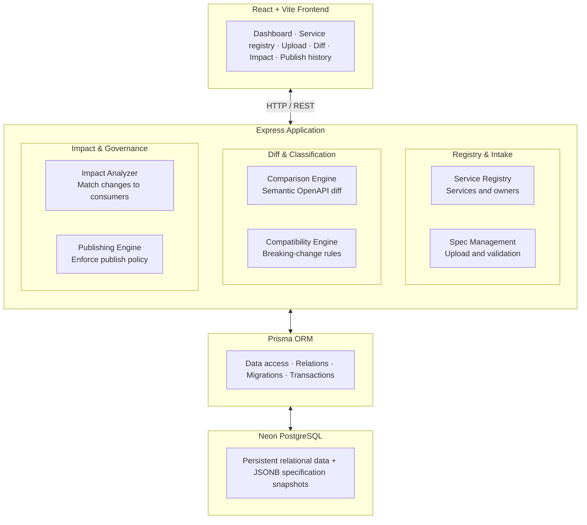

# PLAN.md: Contract Guard (API Contract Registry)
---

## 1. Problem in Our Own Words

### Context & Pain Points

Before an API owner publishes a new API version, Contract Guard should determine what changed, whether those changes could break registered consumers, and which consumers are affected.

At Acko, there are multiple microservices, that communicate over HTTP/REST APIs. For example, the **Mobile App** requests quotes from `quote-api` and files claims via `claims-api`; the **Partner Portal** pushes endorsement updates to `policy-api`; and `payments-svc` monitors policy due dates.

Currently, provider teams iterate on their OpenAPI specifications independently. When an engineering team makes a seemingly innocuous change (such as renaming a field, modifying a path parameter, making an optional request property mandatory, or removing a deprecated field), downstream consumers are unaware. These changes slip past CI and trigger catastrophic runtime failures in production.

This is precisely why **Consumer-Driven Contract (CDC) governance via Contract Guard** is essential: it bridges the repository divide by validating provider spec changes against actual registered consumer requirements (`sends` and `reads`) directly at the schema governance gate.

### Target Users & Value Proposition
These are the main users that I figured out:

1. **API-Owning Developers** - developers responsible for creating, maintaining and publishing API specifications.

2. **Consumer-side developers** – developers whose services consume those APIs and could break when an API changes.

3. **Platform engineering leads** – people concerned with API governance, compatibility and safe publishing.

---

## 2. Product Owner Questions & Clarifications

| # | Question Asked to Product Owner | Product Owner Clarification & Agreed Decision |
|---|----------------------------------|-----------------------------------------------|
| 1 | **How should `x-sunset` dates be interpreted and enforced?** | `x-sunset: 'YYYY-MM-DD'` indicates the deadline after which a deprecated field may be removed. If sunset date is in the future (e.g. `phone` sunsetting `2027-06-30`), removing it is an immediate breaking violation. If sunset date is in the past (e.g. `legacyCode` sunset on `2026-11-01`), removal is expected, but Contract Guard must alert any active consumers still reading it and block uncoordinated deletion. |
| 2 | **What does `x-internal: true` signify for consumers?** | Marks private service-to-service operations (e.g., `/internal/pricing-cache`). External/client consumers (`partner-portal`, `mobile-app`) must be blocked or warned if they attempt to bind contracts to internal endpoints. Provider modifications to internal endpoints do not notify external consumers. |
| 3 | **Should Contract Guard completely reject broken specs (e.g., invalid `$ref`)?** | Yes. A spec with unresolvable `$ref` (like `ClaimDocumnt` in `claims-api/2-channel-and-notes.yaml`) is structurally invalid. It must be rejected at ingestion with a clear error pinpointing the broken reference. |
| 4 | **How should path parameter renames be evaluated (e.g., `/quotes/{id}` vs `/quotes/{quoteId}`)?** | Semantically, both match the route structure, but renaming path parameters breaks consumers who send parameters by name (e.g., `sends: [id]`) or rely on generated SDK signatures. Contract Guard must flag this as a contract break for consumers using `{id}`. |
| 5 | **Can a team ever bypass a blocked breaking publication?** | By default, breaking changes impacting consumers must be strictly stopped. An override mechanism requires a logged approval reason and approver identity, immediately dispatching high-priority webhooks to affected consumer teams. Unrestricted overrides are deferred pending final PO confirmation. |
| 6 | **Where must alerts and notifications be sent?** | To the webhook receiver running at `http://localhost:9900` (or `WEBHOOK_PORT`), posting formatted JSON payloads detailing the service, version, impacted teams, and exact breaking changes. |

---

## 3. Learnings from Similar Real Products

We analyzed leading industry solutions to inform Contract Guard's design:

**1. Pact / Pactflow (Consumer-Driven Contracts):** Pact is an open-source framework for consumer-driven contract testing, while PactFlow (by SmartBear) is a commercial, hosted platform built on top of Pact Broker that adds enterprise management, collaboration, and bi-directional contract testing features. Both help teams verify service-to-service communication (HTTP and event/message queues) in isolation without relying on slow, brittle end-to-end integration tests

- Consumer-driven contracts: A consumer service writes unit tests defining the requests it sends and the minimal responses it expects from a provider.

- Contract generation & publishing: Pact generates a contract file from those consumer tests and publishes it to a Pact Broker (or PactFlow).

**2. Optic / OpenAPI Diff / Stoplight Spectral:** While they all analyze OpenAPI specifications, each solves a different part of the API lifecycle, and understanding how they differ will directly help you architect Contract Guard.

- Core Strength. Behavior-aware diffing between two OpenAPI versions (e.g., comparing a PR branch against main) paired with traffic capture.

- How It Works. Optic resolves $ref pointers across multi-file specs and checks whether changes break existing consumers. Its standout feature was optic capture, which sat as a local proxy during test runs to automatically generate or verify OpenAPI specs against actual HTTP traffic.

---

## 4. Scope & Features

1. **Service & Version Registry:**
   - Register provider services (`quote-api`, `policy-api`, `claims-api`) with owner team metadata.
   - Upload and store OpenAPI 3.0.3 specs in YAML and JSON format.
   - Ingestion validation: validate OpenAPI structure, syntax, and resolve all internal `$ref` pointers; reject invalid specs (e.g. `ClaimDocumnt` typo) with precise diagnostics.
2. **Semantic AST Comparison & Reference Resolution:**
   - Deep dereferencing and comparison of API endpoints, parameters (path, query, header), request bodies, response codes, and response schemas.
   - Reusable component normalization (independent of file organization).
3. **Bidirectional Change Classification Engine:**
   - Categorize changes into:
     - **BREAKING / DANGEROUS:** Endpoint removed, path param renamed, request field added as required, response field removed, enum values removed, type changed.
     - **WARNING / DEPRECATION:** Fields marked `deprecated: true`, `x-sunset` date passed or approaching, optional request fields removed.
     - **NON-BREAKING / SAFE:** New endpoint added, new optional request field added, new response field added, enum values expanded, relaxed constraints.
4. **Consumer Contract Registry:**
   - Ingest consumer definitions (`mobile-app`, `partner-portal`, `payments-svc`, `notifications-svc`).
   - Map consumer usage (`sends` and `reads`) across dot-notation paths (`premium.breakdown[].amount`) and path parameters.
5. **Consumer Impact Analysis:**
   - When a new spec version is submitted, cross-reference detected diffs with active consumer contracts.
   - Identify exactly which consumer services break and why (e.g., `mobile-app` broken by `PriceLine.amount -> value` in `quote-api/3`).
6. **Safe Publishing Gate:**
   - Block `PUBLISH` state if breaking changes affect any registered consumer.
   - Support `DRY_RUN` / check mode for CI pipelines.
   - Allow `OVERRIDE` with mandatory audit rationale and approver.
7. **Webhook Notification Integration:**
   - Automatically POST event payloads to `http://localhost:9900` when specs are published, blocked, or deprecations occur.
8. **Interactive UI Dashboard & CLI:**
   - Clean single-page dashboard displaying services, versions, visual diffs, consumer impact matrices, and publish status.
   - Command-line runner for automated testing and CI gating.
9. **Protection Metrics & Health Summary:**
   - Real-time metrics on dangerous changes intercepted, consumer blast radius, and active deprecations.
---

## 5. System Design, Architecture & Data Model

### Architecture Overview



```
┌────────────────────────────────────────────────────────────────────────┐
│                          React + Vite frontend                         │
│   Dashboard · Service registry · Upload · Diff · Impact · Publish history │
└───────────────────────────────────┬────────────────────────────────────┘
                                    │ HTTP / REST
                                    ▼
┌────────────────────────────────────────────────────────────────────────┐
│ Express application                                                    │
│                                                                        │
│   Service Registry                        Spec Management              │
│   Services and owners                     Upload and validation        │
│                                                                        │
│   Comparison Engine                       Compatibility Engine         │
│   Semantic OpenAPI diff                   Breaking-change rules        │
│                                                                        │
│   Impact Analyzer                         Publishing Engine            │
│   Match changes to consumers              Enforce publish policy       │
└───────────────────────────────────┬────────────────────────────────────┘
                                    │
                                    ▼
┌────────────────────────────────────────────────────────────────────────┐
│ Prisma ORM                                                             │
│ Data access · Relations · Migrations · Transactions                    │
└───────────────────────────────────┬────────────────────────────────────┘
                                    │
                                    ▼
┌────────────────────────────────────────────────────────────────────────┐
│ Neon PostgreSQL                                                        │
│ Persistent relational data + JSONB specification snapshots             │
└────────────────────────────────────────────────────────────────────────┘
```

#### Layer Responsibilities
- **Frontend (React + Vite):** Fast, responsive single-page application providing views for the Dashboard, Service Registry, Spec Upload, Version Diffing, Consumer Impact Analysis, and Publication Audit History.
- **Backend (Express Application):** Modular HTTP service structured into 6 decoupled engines:
  - **Service Registry:** Manages provider services, metadata, and team ownership.
  - **Spec Management:** Ingests specifications, verifies OpenAPI 3.0 syntax, and dereferences `$ref` components.
  - **Comparison Engine:** Performs semantic AST comparisons across paths, parameters, schemas, and types.
  - **Compatibility Engine:** Evaluates breaking-change rules and generates plain-language explanations.
  - **Impact Analyzer:** Correlates detected diffs with registered consumer dependencies (`sends`/`reads`).
  - **Publishing Engine:** Enforces safe publishing policies, blocks dangerous releases, and records audit history.
- **ORM Layer (Prisma ORM):** Provides type-safe data access, model relations, migrations, and transactional integrity.
- **Database (Neon PostgreSQL):** Serverless PostgreSQL handling relational tables (`services`, `dependencies`, `publish_attempts`) alongside native JSONB columns for flexible, indexed AST snapshots.

### Data Model Entities

#### Model 1 — Service
Represents a service in the ecosystem. No `isProvider` or `isConsumer` flag is needed because a service can have both roles based on its API versions and dependency declarations.
```
Field          Type        Notes
id             UUID        Primary key
name           String      Unique, e.g. policy-api
owner          String      Team or responsible owner
description    String?     Optional
createdAt      DateTime    Creation time
updatedAt      DateTime    Last update
```

#### Model 2 — ApiVersion
Represents one uploaded version of a provider's OpenAPI specification. Unique on `(serviceId, versionLabel)`.
```
Field          Type        Notes
id             UUID        Primary key
serviceId      UUID        Provider service
versionLabel   String      e.g. v1, v2
specContent    String      Original YAML/JSON content
parsedSpec     JSON        Normalized parsed OpenAPI document
format         Enum        YAML or JSON
status         Enum        PROPOSED or PUBLISHED
createdAt      DateTime    Upload timestamp
```
- `specContent` preserves the raw uploaded document for display or download.
- `parsedSpec` stores the normalized JSON AST for consistent schema comparison.

#### Model 3 — ConsumerDependency
Represents each declared operation dependency independently. Unique constraint on `(consumerServiceId, providerServiceId, method, path)`.
```
Field               Type        Notes
id                  UUID        Primary key
consumerServiceId   UUID        Consumer service (e.g. payments-svc)
providerServiceId   UUID        Provider service (e.g. policy-api)
method              String      HTTP method (e.g. GET, POST)
path                String      Endpoint path (e.g. /policies/{policyId})
sends               String[]    Fields sent, e.g. ["policyId"]
reads               String[]    Response fields read, e.g. ["status", "premiumDue.amount"]
createdAt           DateTime    Registration timestamp
updatedAt           DateTime    Last update
```
- String arrays store `sends` and `reads` paths directly from consumer declarations.

#### Model 4 — AnalysisRun
Tracks each evaluation run independently. Allows re-evaluating impact when consumer contracts change without re-uploading specifications.
```
Field                Type        Notes
id                   UUID        Primary key
proposedVersionId    UUID        Version being evaluated
baselineVersionId    UUID        Version being compared against
status               Enum        RUNNING, COMPLETED, FAILED
summary              JSON        Counts of changes, risks and impacts
createdAt            DateTime    Analysis timestamp
```

#### Model 5 — CompatibilityChange
Represents one semantic difference discovered between two versions during an analysis run.
```
Field             Type          Notes
id                UUID          Primary key
analysisRunId     UUID          Analysis run that detected it
changeType        String/Enum   FIELD_REMOVED, TYPE_CHANGED, etc.
method            String?       Affected HTTP method
path              String?       Affected endpoint
fieldPath         String?       e.g. premiumDue.amount
classification    Enum          BREAKING, NON_BREAKING, UNKNOWN
beforeValue       JSON?         Previous value (supports any JSON type)
afterValue        JSON?         New value (supports any JSON type)
reason            String        Human-readable explanation
```

#### Model 6 — ImpactFinding
Links one compatibility change to one affected consumer dependency. Unique on `(changeId, dependencyId)`.
```
Field           Type        Notes
id              UUID        Primary key
changeId        UUID        Compatibility change
dependencyId    UUID        Consumer dependency
reason          String      Why this consumer is affected
createdAt       DateTime    Finding timestamp
```
- First-class entity for efficient querying, filtering, and joining affected consumers.

#### Model 7 — PublishAttempt
Records publishing history independently of the current version status.
```
Field            Type        Notes
id               UUID        Primary key
versionId        UUID        Version attempted to publish
analysisRunId    UUID?       Analysis run used for the decision
outcome          Enum        PUBLISHED or BLOCKED
reason           String?     Why publishing was blocked
createdAt        DateTime    Attempt timestamp
```

---

### REST API Endpoints

The API is organized into 5 functional groups covering all 10 mandatory requirements:

#### Group 1: Provider Services
- **`GET /api/services`**  
  Retrieves a list of all registered provider services, including their owner team, latest published version, and total versions count.
- **`POST /api/services`**  
  Registers a new provider service record (name, owner team, description) into the registry.
- **`GET /api/services/:serviceId`**  
  Retrieves the full details and all registered specification versions for a specific provider service.
- **`GET /api/services/:serviceId/versions`**  
  Lists all specification versions (both `PROPOSED` and `PUBLISHED`) for a specific provider service.

#### Group 2: Specifications
- **`POST /api/specs/validate`**  
  Checks if an uploaded OpenAPI YAML or JSON document is syntactically and structurally valid (including resolving internal `$ref` references) without saving it.
- **`POST /api/specs/upload`**  
  Uploads and stores a new specification version as `PROPOSED`, compares it against a baseline version, and analyzes breaking changes and consumer impact.
- **`GET /api/specs/:versionId`**  
  Retrieves the metadata, status, and analysis state of an already uploaded specification version.
- **`GET /api/specs/diff?fromVersionId=...&toVersionId=...`**  
  Compares any two specification versions and returns all semantic differences across paths, parameters, schemas, types, and constraints.
- **`GET /api/specs/:versionId/impact`**  
  Retrieves the consumer blast radius for a proposed version, listing which consumers are broken and by which specific fields.

#### Group 3: Consumers
- **`GET /api/consumers`**  
  Lists all registered consumer services along with the endpoints and fields they send and read.
- **`POST /api/consumers`**  
  Registers a consumer service and its contract declaration (the provider endpoints it calls, what fields it sends, and what fields it reads).
- **`PUT /api/consumers/:consumerId`**  
  Updates an existing consumer's contract declaration (e.g. after a consumer stops using a deprecated field).

#### Group 4: Publishing & Audit
- **`POST /api/specs/publish`**  
  Attempts to publish a proposed version; blocks publication (HTTP 409) if it breaks any registered consumer, or marks it `PUBLISHED` (HTTP 200) if safe.
- **`GET /api/specs/:versionId/publish-history`**  
  Retrieves the audit history of all publish attempts (both blocked and successful) for a specific specification version.
- **`GET /api/publish-attempts`**  
  Retrieves the global audit log of all publication attempts across all services in the system.

#### Group 5: Metrics
- **`GET /api/metrics`**  
  Retrieves real-time protection metrics, such as total registered services, consumers, breaking changes detected, and blocked publish attempts.

---

### End-to-End User Journey Walkthrough

```
[1. Register Service]       POST /api/services (Register policy-api)
          │
[2. Register Consumers]     POST /api/consumers (Import payments-svc, mobile-app contracts)
          │
[3. Pre-flight Validate]    POST /api/specs/validate (Check policy-api v2.0 YAML & $ref integrity)
          │
[4. Upload Proposed Spec]   POST /api/specs/upload (Store v2.0 as PROPOSED, run diff & impact)
          │
[5. Inspect Semantic Diff]  GET /api/specs/diff (Review added/removed/mutated fields)
          │
[6. Review Impact Blast]    GET /api/specs/:id/impact (Identify broken consumers: payments-svc)
          │
[7. Attempt Publication]    POST /api/specs/publish (Gate blocks release with 409 Conflict)
          │
[8. Audit & Metrics Update] GET /api/specs/:id/publish-history & GET /api/metrics
```

---

## 6. Detailed Starter Kit Spec Matrix & Expected Outcomes

| Service | Version Transition | Spec Changes Detected | Impact on Consumers | Expected Gate Outcome |
|---|---|---|---|---|
| **claims-api** | `1-initial.yaml` (1.0.0) | Initial base specification. | All consumer contracts match (`mobile-app`). | `ALLOWED (Initial publish)` |
| **claims-api** | `2-channel-and-notes.yaml` (1.1.0) | Broken `$ref: '#/components/schemas/ClaimDocumnt'`. Added `channel` enum. | Spec parsing fails due to unresolvable reference. | `REJECTED (Invalid Spec: broken $ref)` |
| **claims-api** | `3-channel-and-notes-fixed.yaml` (1.1.0) | Fixed `$ref: ClaimDocument`. Added `assessorNotes`. | Backward-compatible addition. Consumer `mobile-app` unaffected. | `ALLOWED (Safe update)` |
| **claims-api** | `4-approval-later.yaml` (2.0.0) | Added `202 Accepted` response. Removed `amountApproved` from `required` in `Claim`. | `mobile-app` reads `amountApproved`. Status 202 may lack field. Breaking change! | `BLOCKED (Consumer mobile-app impacted)` |
| **policy-api** | `1-initial.yaml` (1.0.0) | Initial base specification. | All consumer contracts match (`notifications-svc`, `payments-svc`, `partner-portal`). | `ALLOWED (Initial publish)` |
| **policy-api** | `2-deprecations.yaml` (1.1.0) | Added `deprecated: true` and `x-sunset: '2026-11-01'` on `legacyCode`; `x-sunset: '2027-06-30'` on `phone`. | `payments-svc` reads `legacyCode`. Sunset warning triggered. Non-breaking yet. | `ALLOWED (Warning / Sunset Alert sent to Webhook)` |
| **policy-api** | `3-remove-old-fields.yaml` (2.0.0) | Removed `legacyCode` from `Policy` and `phone` from `Holder`. | `payments-svc` reads `legacyCode` -> Hard break! | `BLOCKED (Consumer payments-svc broken by legacyCode removal)` |
| **policy-api** | `4-endorsement-rules.yaml` (2.1.0) | Added required `requestedBy` to `EndorsementRequest`. Removed `VEHICLE` from `type` enum. | `partner-portal` sends `[policyId, type, details]` without `requestedBy` -> Hard break! | `BLOCKED (Consumer partner-portal broken by new required field)` |
| **quote-api** | `1-initial.yaml` (1.0.0) | Initial base specification with `x-internal: true` on `/internal/pricing-cache`. | Base contracts established (`mobile-app`, `partner-portal`, `notifications-svc`). | `ALLOWED (Initial publish)` |
| **quote-api** | `2-reorganised.yaml` (1.1.0) | Inlined schemas. Renamed path param `/quotes/{id}` -> `/quotes/{quoteId}`. | `mobile-app` and `notifications-svc` send parameter `id` and use `/quotes/{id}` -> Parameter mismatch. | `BLOCKED (Consumers mobile-app, notifications-svc parameter mismatch)` |
| **quote-api** | `3-price-lines.yaml` (2.0.0) | Renamed `PriceLine.amount` to `PriceLine.value`. Added required query param `region` to internal cache. | `mobile-app` reads `premium.breakdown[].amount` -> Hard break! | `BLOCKED (Consumer mobile-app broken by missing response field)` |
| **quote-api** | `4-ncb-and-taxes.yaml` (2.1.0) | Added optional `ncbPercent` to Rider and optional `taxes` to PremiumDetails. | Backwards-compatible additive changes. | `ALLOWED (Safe update)` |

---

## 7. Test Plan & Verification Strategy

### Level 1: Unit Tests
- **Spec Parser & Ref Resolver:**
  - Verify dereferencing for nested components, array items, and parameter schemas.
  - Assert that `ClaimDocumnt` triggers a specific `UnresolvedReferenceError`.
- **Semantic Differ:**
  - Test detection of added/removed endpoints, modified verbs, parameter additions, type mutations, enum expansions vs contractions.
  - Test directional breaking rules (new required body property = breaking; new optional body property = safe).
- **Field Path Matching:**
  - Validate dot-notation paths (`premium.breakdown[].amount`) against complex nested array schemas.

### Level 2: Integration Tests
- **API Flow:**
  - Ingest service -> upload spec v1 -> upload spec v2 -> assert diff response structure.
  - Register consumer -> upload breaking spec -> assert response HTTP 409 / status `BLOCKED` with affected consumer list.
- **Webhook Dispatcher:**
  - Verify webhook notification payload dispatched to mock receiver upon publish attempts.

### Level 3: Acceptance / End-to-End Suite
- Automated evaluation runner executing against all 12 sample specs and 4 consumer files in `specs/` and `consumers/`.
- Asserts that all known breakages (`claims-api` v2 ref error, `claims-api` v4 amountApproved, `policy-api` v3 legacyCode, `policy-api` v4 requestedBy, `quote-api` v2 path param, `quote-api` v3 amount->value) are accurately intercepted and blocked.

---

## 8. Measurable Success Metrics

1. **Dangerous Changes Intercepted (100% Target):** Zero undetected breaking changes across the 12 test specs.
2. **False Positive Rate (< 5%):** Non-breaking additions (e.g., `4-ncb-and-taxes.yaml`) must be correctly approved without manual intervention.
3. **Consumer Blast Radius Clarity:** 100% of detected breaks correctly identify the exact impacted consumer service, team, and problematic field path.
4. **Time to Detect (< 200ms):** Spec diffing and consumer impact calculation finishes in under 200ms per version.
5. **Operational Simplicity:** Single-command startup (`docker compose up --build` or `./run.sh`).

---